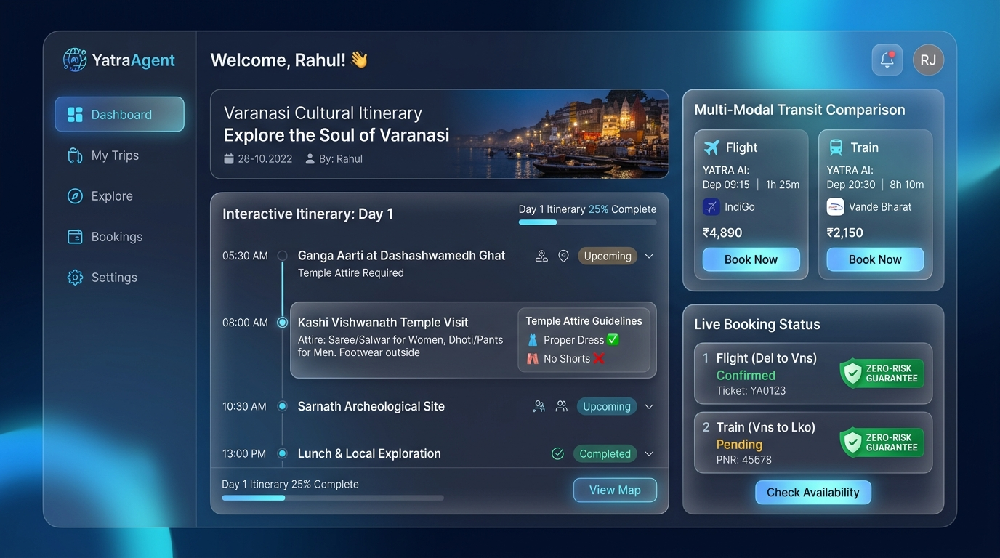
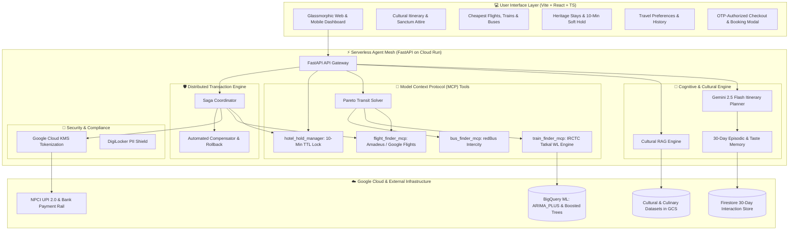
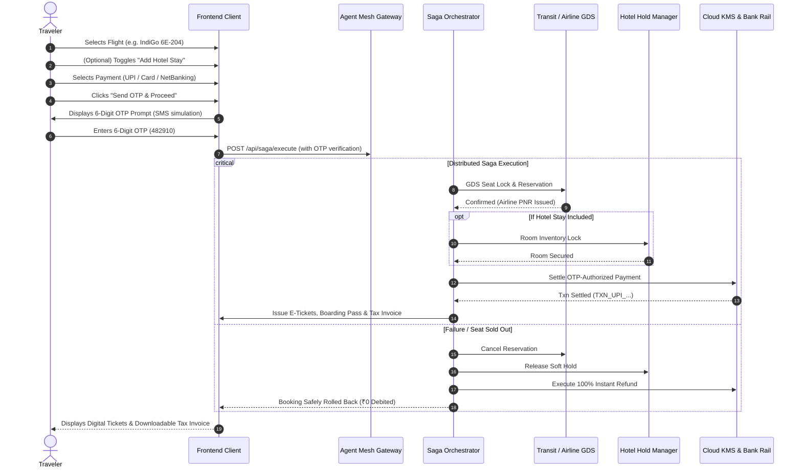
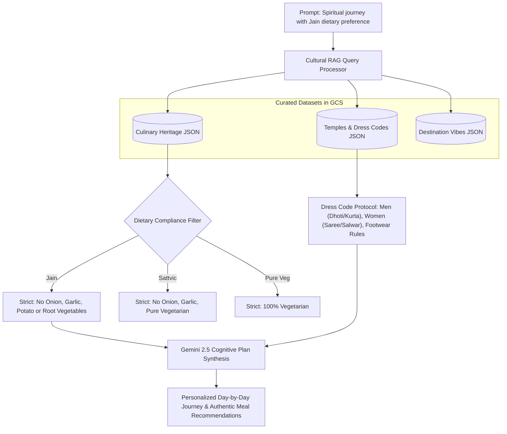

# 🪷 YatraAgent: Autonomous & Culturally Aware Travel Platform

> **Zero-Touch, Culturally Aware Autonomous Travel Planning and Multi-Modal Booking Platform on Google Cloud.**



---

## 🌟 Executive Overview & Mission

**YatraAgent** is a next-generation autonomous travel planning and multi-modal booking platform specifically architected for Indian cultural journeys, pilgrimages, and heritage tourism. It solves the fragmentation of Indian travel planning by unifying:
1. **Gemini 2.5 Cognitive Planner** with RAG-grounded temple attire, rituals, and strict regional dietary filters (*Jain, Sattvic, Pure Veg*).
2. **Multi-Modal Transit Optimizer (MCP)** with Amadeus/Google Flights GDS integration, IRCTC Tatkal waitlist predictors, and redBus connectivity.
3. **10-Minute Heritage Stay Soft-Hold & Lock Manager** to prevent room loss while organizing transit.
4. **Mandatory OTP Payment Authorization Rail** with Cloud KMS encryption and instant ticket issuance.
5. **Distributed Multi-Leg Saga Coordinator** with 100% automated compensatory rollback and instant refund guarantees.

---

## 📐 System Architecture



---

## 🔄 End-to-End Multi-Leg Saga Booking & OTP Flow



---

## 🍛 Cultural RAG & Dietary Compliance Graph



---

## 🚀 Key Features & MVP Highlights

| Feature Area | Implementation Details |
| :--- | :--- |
| **Cognitive Planner** | Gemini 2.5 Flash synthesizes complete multi-day itineraries with step-by-step transit graphs and ritual schedules. |
| **Cultural & Culinary RAG** | Strict dietary compliance engine filtering authentic regional dishes for Varanasi, Madurai, Rameshwaram, Amritsar, Tirupati, and Kerala. |
| **Sanctum Attire Alerts** | Grounded dress code guidelines for men and women, footwear protocols, Aarti timings, and wheelchair accessibility notes. |
| **Pareto Transit Engine** | Multi-modal solver comparing Lowest Price (Bus), Best Value (Vande Bharat Train with IRCTC WL confirmation chance), and Fastest (Direct Flight). |
| **Autonomous Flight Booking** | Direct airline GDS reservation with instant **Airline PNR**, **E-Ticket Number**, auto seat allocation, and digital boarding pass generation. |
| **10-Min Hotel Soft-Hold** | Ephemeral inventory lock securing heritage stays while the traveler reviews transit options. |
| **Mandatory OTP Verification** | Multi-step payment authorization requiring 6-digit OTP verification across UPI (GPay/PhonePe), Cards, and Net Banking. |
| **Separated Bookings** | Flight, Train, and Bus bookings are completely isolated from accommodation by default, with an optional 1-click bundle checkbox. |
| **Distributed Saga Engine** | Multi-leg transaction coordinator with 100% automated compensatory rollback protecting travelers from partial booking failures. |

---

## 💎 The X-Factors (Why YatraAgent Stands Out)

1. **Zero-Touch Multi-Leg Protection**: In traditional platforms, if a flight gets booked but the return train or hotel fails, travelers face manual cancellations and steep penalties. YatraAgent's Saga Coordinator makes multi-leg bookings **atomic**—all succeed together, or everything is automatically refunded with zero cancellation fees.
2. **Culturally Aware Cognitive Engine**: Travel apps fail in India when they suggest non-vegetarian dining in sacred zones or ignore temple dress codes. YatraAgent natively understands Vedic temple customs, Aarti timings, and strict Jain/Sattvic dietary rules.
3. **BigQuery ML Tatkal & Fare Forecaster**: Evaluates historical rail waitlists and flight pricing trends to recommend the mathematically optimal booking window.

---

## 🛠️ Technology Stack

- **Frontend**: React 18, TypeScript, Vite, Tailwind CSS, Lucide Icons
- **Backend API**: Python 3.11+, FastAPI, Uvicorn, Pydantic
- **AI & Reasoning**: Google Gemini 2.5 Flash / Pro, Retrieval-Augmented Generation (RAG)
- **Analytics & ML**: Google BigQuery ML (ARIMA_PLUS & Boosted Trees)
- **Security & Privacy**: Google Cloud KMS (Envelope Encryption AES-256-GCM), DigiLocker tokenization
- **Orchestration**: Cloud Workflows, Distributed Saga Coordinator

---

## 💻 Local Setup & Quickstart Guide

### Prerequisites
- Node.js v18+ & npm
- Python 3.10+ & pip
- Git

### 1. Clone Repository
```bash
git clone https://github.com/Jivikadixit/YatraAgent.git
cd YatraAgent
```

### 2. Start Backend Agent Mesh Server
```bash
# Navigate to project root
cd c:/Google_Patchmomma/YatraAgent/agent-mesh

# Install dependencies
pip install -r requirements.txt

# Run FastAPI Server
python -m uvicorn app.main:app --host 127.0.0.1 --port 8000 --reload
```
*API Swagger Documentation is available at `http://127.0.0.1:8000/docs`*

### 3. Start Frontend Client
```bash
# Navigate to frontend folder
cd c:/Google_Patchmomma/YatraAgent/frontend

# Install dependencies
npm install

# Start Vite Development Server
npm run dev
```
*Dashboard will open at `http://localhost:5173/`*

---

## 🧪 Automated Testing

Run the comprehensive 8-stage automated test suite:
```bash
python test_mesh_server.py
```

**Test Suite Coverage:**
```text
--- 1. Testing Cultural RAG Engine --- [OK]
--- 2. Testing Cognitive Itinerary Planner --- [OK]
--- 3. Testing MCP Transit Optimizer & IRCTC BQML --- [OK]
--- 4. Testing 10-Minute Hotel Soft Hold Manager --- [OK]
--- 5. Testing Google Cloud KMS Security Rails --- [OK]
--- 6. Testing BigQuery ML Dynamic Forecasts --- [OK]
--- 7. Testing Distributed Saga Booking & OTP Protection --- [OK]
--- 8. Testing Saga Chaos Compensatory Rollback --- [OK]

[SUCCESS] ALL 8 TESTS PASSED WITH 100% SPECIFICATION CONFORMANCE!
```

---

## 📄 License & Attribution

Built with ❤️ by **Jivika Dixit** using Google Cloud, Gemini 2.5, and the Antigravity Agentic Platform.
Licensed under the [MIT License](LICENSE).
